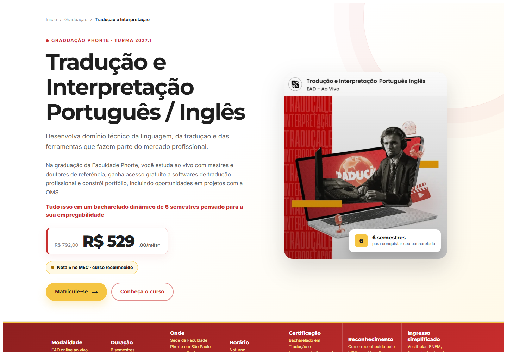
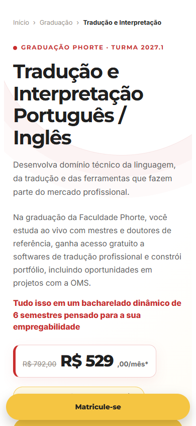
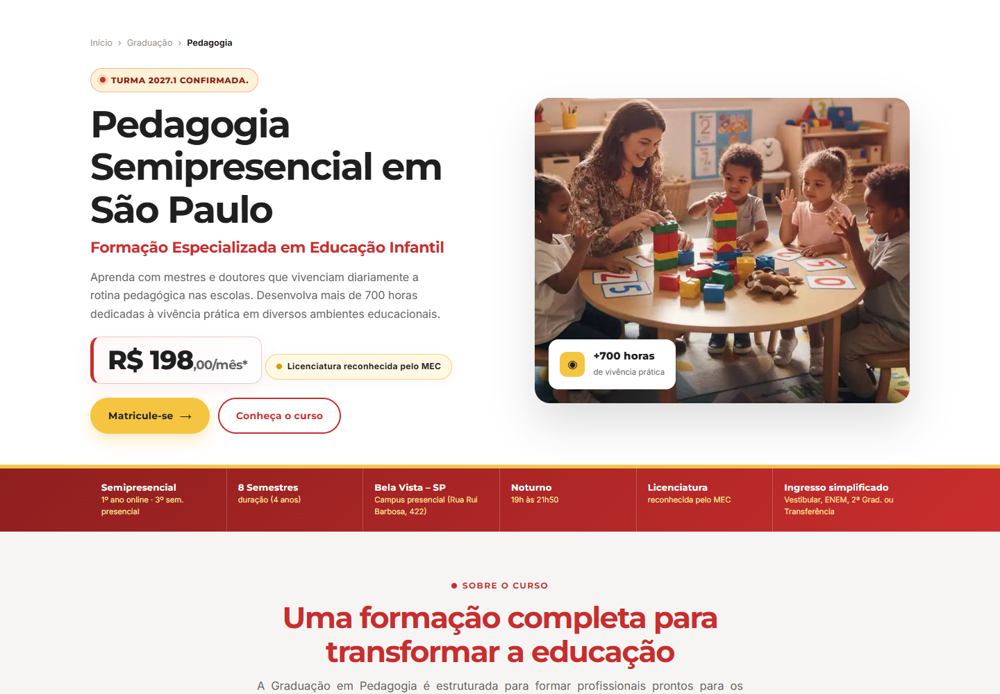
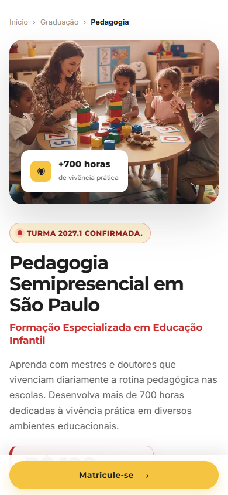
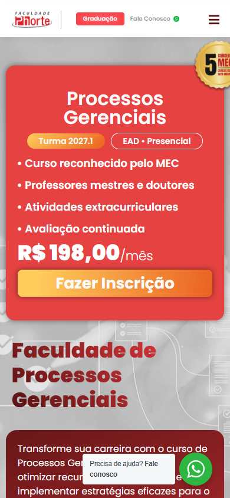
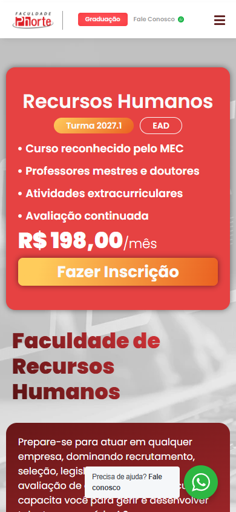
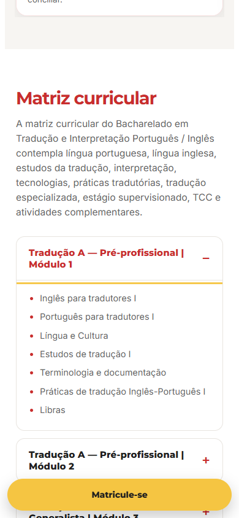
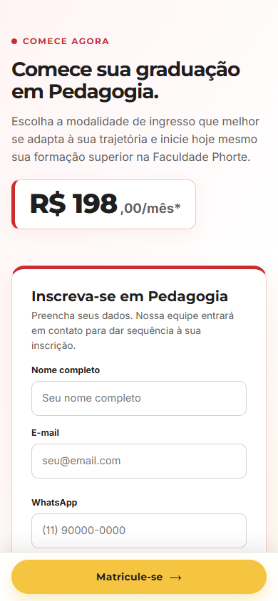
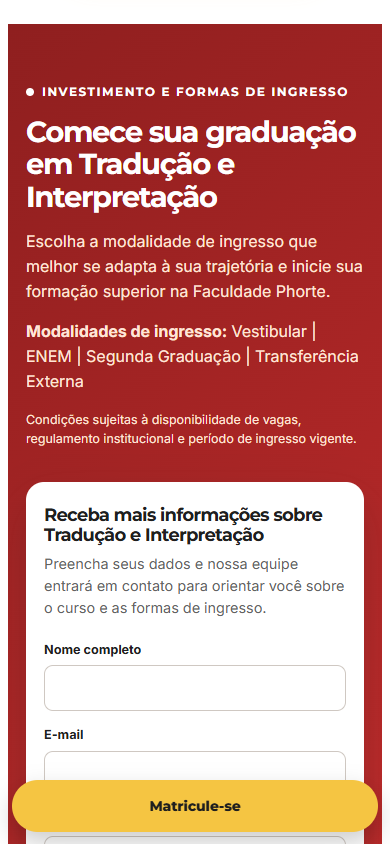

# Revisão de UI — referências e páginas atuais de gestão

**Data:** 2026-10-09. **Escopo:** preparação visual de Administração, Marketing, Processos Gerenciais e Recursos Humanos. **Estado:** revisão das referências anteriores à produção. As primeiras versões novas seguem estas recomendações; sua revisão visual ainda está pendente. [Estado da produção](producao-lps-gestao.md).

## 1. Método e limites

Revisão visual dos heroes das quatro páginas oficiais atuais e dos heroes, grade e formulários das referências locais. As capturas foram produzidas com navegador automatizado na sessão de levantamento. Foram observadas a abertura por clique e a reabertura por Enter do primeiro acordeão da grade de Tradução. Os formulários foram inspecionados sem envio.

Viewports das evidências: **1440 × 1000 px** no desktop e **390 × 844 px** no mobile. As imagens estão arquivadas em [assets/revisao-ui/2026-10-09](assets/revisao-ui/2026-10-09/), com doze arquivos referenciados abaixo.

| Página | Origem | Trecho observado |
|---|---|---|
| Pedagogia 2027.1 | [HTML local](../pedagogia/index-claro-2027-1.html) | Hero desktop/mobile e formulário mobile |
| Tradução | [HTML local](../traducao%20e%20interpretacao/index.html) | Hero desktop/mobile, grade e formulário mobile |
| Administração atual | [Página oficial](https://faculdadephorte.edu.br/graduacao/administracao/) | Hero desktop/mobile |
| Marketing atual | [Página oficial](https://faculdadephorte.edu.br/graduacao/marketing/) | Hero mobile |
| Processos Gerenciais atual | [Página oficial](https://faculdadephorte.edu.br/graduacao/processos-gerenciais/) | Hero mobile |
| Recursos Humanos atual | [Página oficial](https://faculdadephorte.edu.br/graduacao/recursos-humanos/) | Hero mobile |

Não foram auditados todos os componentes, todos os breakpoints, os leitores de tela, a integração do formulário ou o processo externo de matrícula. Contraste não foi medido quantitativamente. O resultado não representa uma auditoria completa de acessibilidade. A revisão em desktop das páginas oficiais se limita a Administração; as outras três têm evidência mobile.

## 2. Leitura geral

As referências locais oferecem uma base consistente de superfícies claras, tipografia Montserrat/Inter, títulos vermelhos, CTA amarelo e cards arredondados. A organização dos dados acadêmicos, os labels visíveis dos formulários e o uso de acordeões nativos em Tradução são padrões aproveitáveis.

Os principais ajustes para a nova família são reduzir o esforço no hero mobile, manter a ação fixa fora dos campos, preservar selos dentro do card e tornar explícito quando um botão abre inscrição oficial ou solicita contato. As páginas atuais também repetem a apresentação do curso depois do card comercial, alongando o início da leitura.

### Prioridades

- **P1:** impede ou atrapalha uma ação central no trecho observado.
- **P2:** prejudica compreensão, hierarquia ou leitura; resolver na montagem comum.
- **P3:** refinamento de consistência, sem bloqueio observado.

## 3. Achados e recomendações

| ID / prioridade | Achado e evidência | Impacto | Recomendação aplicável às novas LPs |
|---|---|---|---|
| UI-01 / P1 | CTA fixo sobre o conteúdo inferior dos formulários de Pedagogia e Tradução; capturas 11 e 12 | Reduz a área legível dos campos e pode disputar atenção com o envio | Reservar altura real da barra e safe area; ocultar ao entrar no formulário ou CTA final e durante foco em campo |
| UI-02 / P2 | Pedagogia coloca a imagem antes do título no mobile; Tradução mantém hero longo; capturas 02 e 04 | Curso, proposta e próximo passo aparecem tarde na sequência | Título → proposta curta → oferta/ação → imagem; deslocar texto extenso para apresentação |
| UI-03 / P2 | Heroes atuais combinam card comercial, nome repetido e apresentação extensa; capturas 05 a 09 | A primeira leitura contém várias entradas para a mesma informação | Unificar nome e proposta no hero, manter oferta concisa e usar apresentação para o aprofundamento |
| UI-04 / P2 | Selos de Administração e Processos Gerenciais ficam cortados à direita no mobile; capturas 06 e 08 | Prova visual incompleta e composição ultrapassando a área disponível | Posicionar selo dentro do card, usar contain e dimensões responsivas; só exibir claim regulatório validado |
| UI-05 / P2 | Em Pedagogia, o hero “Matricule-se” abre rota externa; CTA fixo/final com o mesmo texto apontam para contato. Em Tradução, hero/fixo abrem vestibular e ações internas apontam para contato | Rótulos não tornam a natureza de cada próximo passo igualmente clara | “Fazer inscrição” para destino oficial; “Receber informações” para formulário; submit de contato sem promessa de matrícula |
| UI-06 / P2 | As referências têm estruturas diferentes de ficha; detalhes acadêmicos longos competem com a leitura rápida | Dificulta comparação entre cursos e aumenta densidade | Resumir seis campos comuns e mover frequência, polos, avaliações e exceções para modalidade/FAQ |
| UI-07 / P2 | Nas páginas oficiais, botão com gradiente e rótulo branco disputa atenção com oferta vermelha; controles flutuantes ocupam o rodapé visível; capturas 06 a 09 | Hierarquia de ação menos clara; contraste do botão precisa de conferência | Adotar CTA amarelo com texto escuro, secundário menos dominante e revisar coexistência com chat; medir contraste na implementação |
| UI-08 / P3 | Acordeão nativo de Tradução respondeu ao clique e ao Enter; captura 10 | Boa base para acessar a grade em espaço reduzido | Reutilizar details/summary em grade e FAQ; preservar foco visível e títulos que quebram linha |

UI-05 também usa inspeção dos destinos no HTML local. UI-06 é uma recomendação de padronização por comparação de composição; não representa teste de legibilidade de todas as fichas. UI-07 registra uma necessidade de medição, sem afirmar falha de contraste não medida.

## 4. Evidências por etapa

### Etapa A — Hero das referências locais

#### Capturas 01 e 02 — Tradução

Desktop: imagem e texto em colunas, oferta e ação integradas à composição clara. O bloco é extenso; a observação de layout registrou aproximadamente 906 px de altura e a primeira ação normal perto de 803 px a partir do topo do documento no preview capturado.

Mobile: título em várias linhas seguido por texto denso; CTA fixo dá acesso à inscrição, mas não reduz o volume de informação antes das ações do hero. UI-02: encurtar a apresentação inicial e conservar título/proposta/ação no início.

#### Capturas 03 e 04 — Pedagogia 2027.1

Desktop: referência de card claro, título vermelho, imagem contextual e oferta com CTA amarelo. Aproveitar a linguagem visual e a divisão em colunas.

Mobile: imagem aparece antes do título; descrição e oferta ficam mais abaixo. A ação fixa ocupa parte da área inferior da oferta. UI-02: ordenar o conteúdo prioritário antes da imagem. UI-01: prever espaço real para a barra.

### Etapa B — Heroes das quatro páginas atuais

#### Capturas 05 e 06 — Administração

Desktop: oferta e imagem apresentam o curso, seguidas por novo título e apresentação. UI-03: reduzir repetição no início e separar resumo comercial de aprofundamento editorial.

Mobile: selo ultrapassa a borda direita; oferta vermelha, botão em gradiente e chat ocupam uma área reduzida. UI-04: conter o selo. UI-07: hierarquia comum de ações e convivência com elementos flutuantes.

#### Captura 07 — Marketing

Oferta ocupa o primeiro bloco; nome e apresentação reaparecem na sequência. UI-03: hero único, com proposta curta e oferta legível, seguido de apresentação específica. UI-07: conferir botão e chat na área visível.

#### Captura 08 — Processos Gerenciais

Selo cortado à direita, com oferta e botão dominando o topo. UI-04: não depender de posição externa para encaixar a prova. A nota representada pelo selo também precisa de validação, conforme o [dossiê do curso](../processos-gerenciais/referencias/fontes-e-pendencias.md).

#### Captura 09 — Recursos Humanos

Card comercial seguido por novo título e texto de apresentação. UI-03 e UI-07: hierarquia de hero comum, menor repetição e ação principal com destaque consistente.

### Etapa C — Grade da referência de Tradução

#### Captura 10 — Grade mobile

O primeiro módulo foi fechado por clique e reaberto por Enter, com foco em summary. A verificação pontual registrou um H1 e ausência de overflow horizontal no preview de Tradução a 390 px. UI-08: reutilizar essa base sem substituir controles nativos. Esses resultados não se estendem automaticamente aos quatro novos documentos ou a todas as interações das referências.

### Etapa D — Solicitação de contato nas referências

#### Captura 11 — Formulário de Pedagogia

Labels visíveis facilitam identificar campos. A ação fixa ocupa a área inferior do formulário. UI-01: ocultar a barra durante a interação e reservar espaço no restante da página. UI-05: usar “Receber informações” quando o destino for contato.

#### Captura 12 — Formulário de Tradução

Boa base de labels e agrupamento do formulário; a barra fixa permanece sobre a parte inferior do conteúdo. A barra de Tradução abre vestibular externo, enquanto o formulário solicita contato. UI-01 e UI-05: retirar a competição entre ações durante o preenchimento e distinguir seus resultados.

## 5. Aplicação ao desenho das novas LPs

1. **Primeiro contato:** apresentar nome, proposta, duração/formação e ação antes da imagem no mobile; dados comerciais somente após validação.
2. **Entendimento do curso:** usar ficha comum de seis itens e separar modalidade, competências e prática em blocos curtos.
3. **Confiança:** mostrar docentes e provas correspondentes; selos legíveis, sem extrapolar o container ou usar dados de outra graduação.
4. **Consulta da grade:** manter módulos e disciplinas com acordeões nativos, títulos legíveis e abertura por teclado.
5. **Decisão e contato:** oferecer inscrição oficial e pedido de informações com rótulos distintos; ocultar ação fixa ao alcançar o formulário.
6. **Encerramento:** FAQ específico e CTA final com próximo passo explícito; não repetir uma promessa de matrícula em um botão de contato.

O [guia de arquitetura](arquitetura-lps-gestao.md) traduz essas recomendações em contratos de componentes, responsividade, isolamento de CSS, inicialização por página e containers do Elementor.

## 6. Conferência prevista após a montagem

Esta lista é orientação para a implementação futura, não resultado de testes das quatro novas LPs:

- Capturar heroes a 320/390 px, tablet e desktop para conferir ordem, quebra de título e leitura da oferta.
- Medir contraste de textos, botões, bordas e foco nas superfícies efetivas.
- Abrir grade e FAQ por clique e teclado; conferir foco e disciplinas sem corte.
- Percorrer formulário com teclado, verificar labels, erros e comportamento com teclado virtual.
- Confirmar ocultação da barra quando formulário/CTA final aparecem e sua área inferior em aparelhos com safe area.
- Conferir destinos de cada CTA e mensagem de sucesso coerente com contato ou inscrição.
- Revisar cortes de fotos, selos e identidade de docentes; verificar ausência de overflow.
- Configurar e verificar o formulário oficial antes da publicação, separadamente do preview demonstrativo.

Voltar ao [índice dos documentos](README.md).
