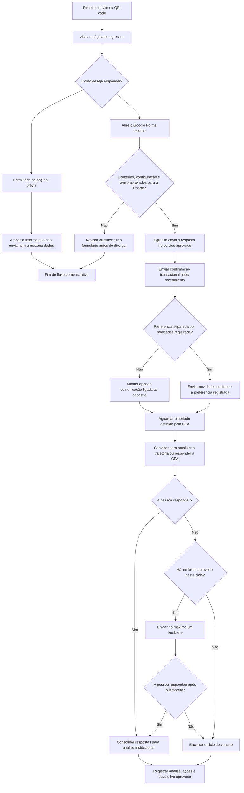

# Comunicação pós-cadastro de egressos

**Status:** proposta editorial para validação de Marketing, CPA, TI e responsável por privacidade  
**Atualizado em:** 21 de outubro de 2026

## 1. Objetivo

Organizar o que acontece depois que um egresso demonstra interesse ou envia um cadastro: confirmar o recebimento, explicar o uso esperado das respostas e, em outro momento, convidar a pessoa para contribuir com o acompanhamento institucional.

As mensagens deste documento são rascunhos. A instituição deve aprovar finalidade, público, canal, base legal aplicável, periodicidade, aviso de privacidade e processo de atendimento antes de iniciar uma coleta ou disparo real.

## 2. Estado atual e caminhos do protótipo

- **Formulário nesta página:** demonstração visual e preenchível. O site estático não envia nem armazena o que for digitado. A mensagem exibida após o botão de simulação informa isso.
- **Google Forms:** o [link fornecido pela equipe](https://docs.google.com/forms/d/e/1FAIpQLSc9dxx2OvM-XaKmRP9Z4K9nuZ0Wu29x5ObMRoXz3t_h6rRPzg/viewform) abre um serviço externo. O conteúdo que está nesse link inclui perguntas específicas sobre Direito na UnB. Ele precisa ser revisado e substituído ou aprovado para o contexto da Faculdade Phorte antes de ser divulgado como formulário de egressos.
- **E-mail e acompanhamento:** o protótipo não dispara mensagens, não cria cadastro e não controla preferências.

O endereço externo está visível como opção nesta prévia, com aviso de que o destino precisa ser validado. O funcionamento do site local não confirma que o formulário externo esteja adequado à Phorte.

## 3. Jornada proposta

1. **Convite:** próximo à conclusão do curso ou em uma ação de reativação, a Faculdade apresenta o propósito e o link do cadastro aprovado.
2. **Cadastro:** o egresso escolhe um formulário publicado pela instituição e fornece somente os dados definidos para a finalidade aprovada.
3. **Confirmação:** após o serviço registrar uma resposta, a pessoa recebe uma confirmação transacional com instruções para correção ou contato.
4. **Acompanhamento da CPA:** em um período definido pela CPA, a Faculdade pode convidar o egresso a compartilhar uma atualização breve sobre sua trajetória e sua experiência com a formação.
5. **Lembrete:** no máximo um lembrete planejado por ciclo; encerrar o contato se a pessoa pedir para não receber lembretes daquele processo.
6. **Análise e devolutiva:** a CPA consolida resultados compatíveis com sua finalidade, registra ações decorrentes e publica apenas devolutivas institucionais aprovadas.
7. **Novidades:** newsletter e comunicações de relacionamento são administradas separadamente, conforme preferência e regras aprovadas.

## 4. Fluxograma Mermaid

Todos os e-mails devem identificar a Faculdade e oferecer o canal institucional aplicável para correção ou solicitações de privacidade. Mensagens de newsletter precisam permitir ajustar ou encerrar essa preferência. O convite à CPA deve explicar seu objetivo e não deve ser confundido com publicidade.

## 5. Modelos de mensagem

Substituir os itens entre colchetes e aprovar o texto com as áreas responsáveis antes de usar. Não preencher os links enquanto o formulário, o aviso de privacidade e o canal de atendimento não estiverem definidos.

### 5.1 Convite para atualização cadastral

**Assunto:** Sua história com a Phorte continua

Olá, [nome].

Você concluiu sua formação na Faculdade Phorte e queremos manter esse canal de contato. Estamos atualizando as informações de egressos para conhecer suas trajetórias e apoiar o acompanhamento institucional.

Se quiser participar, acesse o formulário aprovado: [link do formulário].

O aviso de privacidade explica a finalidade e como falar com a Faculdade sobre seus dados: [link do aviso e canal].

Faculdade Phorte  
[assinatura institucional]

### 5.2 Confirmação de recebimento

**Assunto:** Recebemos sua resposta — Egressos Phorte

Olá, [nome].

Recebemos sua resposta ao formulário de egressos em [data]. As informações serão tratadas para [finalidade aprovada], conforme o aviso de privacidade: [link].

Para corrigir uma informação ou falar sobre seus dados, use [canal institucional].

Obrigado por compartilhar sua trajetória.

Faculdade Phorte  
[assinatura institucional]

Enviar somente quando o sistema confirmar que a resposta foi registrada. Esta mensagem é transacional; não incluir propaganda ou inscrição automática em newsletter.

### 5.3 Lembrete único

**Assunto:** Um lembrete sobre o cadastro de egressos da Phorte

Olá, [nome].

Este é um lembrete sobre o convite para [atualizar o cadastro / responder à pesquisa da CPA]. Se você já respondeu, agradecemos e pode desconsiderar esta mensagem.

Formulário: [link aprovado]

Para não receber outros lembretes deste ciclo, acesse [opção ou canal de descadastro].

Faculdade Phorte  
[assinatura institucional]

Enviar no máximo uma vez por ciclo aprovado. O intervalo deve ser decidido pela Faculdade e registrado no calendário de comunicação.

### 5.4 Convite de acompanhamento da CPA

**Assunto:** Como sua formação acompanha sua trajetória?

Olá, [nome].

A CPA da Faculdade Phorte está realizando [nome ou descrição breve do acompanhamento]. Queremos ouvir sua experiência após a conclusão do curso para contribuir com a avaliação e o aprimoramento institucional.

Conheça o objetivo e participe pelo formulário: [link aprovado].

Veja o aviso de privacidade ou fale com a Faculdade: [link/canal].

Faculdade Phorte  
[assinatura institucional]

Definir o período e as perguntas com a CPA. Informar duração somente depois de medir o tempo real de resposta.

### 5.5 Newsletter e novidades

**Assunto:** Novidades da comunidade Phorte

Olá, [nome].

Você escolheu receber novidades da Faculdade Phorte. Nesta mensagem, compartilhamos [resumo do conteúdo].

Para ajustar sua preferência ou deixar de receber novidades, acesse [link de preferências/descadastro].

Faculdade Phorte  
[assinatura institucional]

Não usar a confirmação do cadastro para incluir automaticamente o egresso nesta lista. Registrar a escolha separada conforme o processo aprovado.

## 6. Regras editoriais e operacionais

- Confirmar o registro antes de enviar a confirmação.
- Separar mensagens transacionais, convite de pesquisa e newsletter.
- Não dizer que existem vagas, benefícios, descontos, eventos ou serviços enquanto não estiverem confirmados e operacionais.
- Não prometer uma área interna ou atendimento automático que ainda não exista.
- Não incluir dados do cadastro no assunto ou em links abertos de e-mail.
- Definir responsáveis e acesso: CPA pela pesquisa e análise; Marketing pelo conteúdo e preferências; TI pela operação técnica; Registro Acadêmico pela validação de informações acadêmicas; área responsável por privacidade pelo aviso e canal de direitos.
- Registrar versão aprovada da mensagem, público, finalidade, data de disparo e regra de frequência.
- Aplicar a retenção, segurança, acesso e tratamento de pedidos definidos pela instituição.

## 7. Preparação para produção

Antes de sair da prévia:

1. Confirmar o conteúdo correto do Google Forms ou substituí-lo por um formulário específico para egressos Phorte.
2. Definir a finalidade de cada campo e revisar o aviso apresentado no ponto de coleta.
3. Aprovar responsáveis, acesso, armazenamento, retenção, segurança e canal de privacidade.
4. Escolher a ferramenta que confirma recebimento e envia e-mails; a página estática não faz essas operações.
5. Validar modelos e calendário com Marketing, CPA, TI e as áreas responsáveis.
6. Fazer um piloto controlado e corrigir dúvidas antes de ampliar o público.
